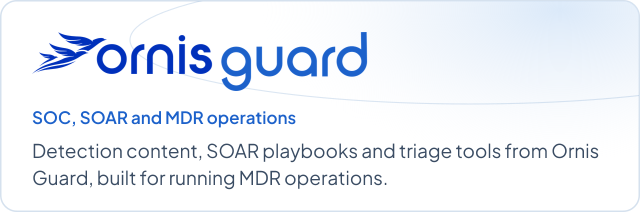
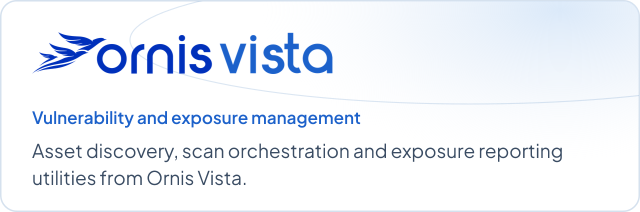
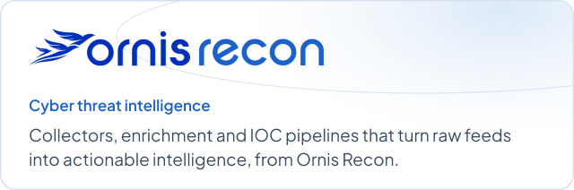

<!--
  OrnisLab organization profile — shown at github.com/OrnisLab
  Source: github.com/OrnisLab/.github → profile/README.md
  Images load from this repo's main branch (profile/assets). To change their wording,
  edit tools/build_assets.py and re-run it.

  Every image has a light and a dark version; this page uses the light ones for everyone.
  To follow each visitor's GitHub theme instead, wrap an image like this:
    <picture>
      <source media="(prefers-color-scheme: dark)" srcset=".../banner-dark.svg">
      
    </picture>
-->

  
  
  
  
  

**OrnisLab** is where İşNet opens up its security work. *Ornis* is the cybersecurity product family built at [İşNet](https://www.isnet.net.tr); on GitHub, the name stands for **O**pen **R**esearch **N**etwork for **I**ntelligent **S**ecurity.

We publish two kinds of projects here:

- **Tools from the Ornis products.** Components and utilities that came out of building Ornis Guard, Ornis Vista and Ornis Recon.
- **Our SecOps stack.** The open-source solutions İşNet’s security operations rely on, together with the configurations, integrations and playbooks we use with them.

## Explore by domain

  
  

  
  

Each card opens the repositories in that domain.

## Projects

> [!NOTE]
> The first OrnisLab repositories are being prepared for release. Follow the organization to hear about them as they land.

<!--
  When repositories go public, replace the note above with a table like this one
  and pin the flagship repositories on the organization page.

| Project | Domain | What it does | Status |
| :-- | :-- | :-- | :-- |
| [repo-name](https://github.com/OrnisLab/repo-name) | Guard | One sentence on what it does for the user. |  |
| [repo-name](https://github.com/OrnisLab/repo-name) | Recon | One sentence on what it does for the user. |  |
| [repo-name](https://github.com/OrnisLab/repo-name) | SecOps | One sentence on what it does for the user. |  |
-->

## How we build

- **Proven before published.** Every project starts in Ornis product engineering or in İşNet’s own security operations.
- **Runs on your infrastructure.** Self-hosted by design: your logs, findings and intelligence stay where you put them.
- **Built on open standards.** We work with formats the security community already shares, such as MITRE ATT&CK, Sigma, STIX/TAXII and CVE/CVSS, and contribute back where we can.
- **Clear about status.** Each repository says whether it is experimental, beta or stable, what it supports and where to get help.

## Be part of our team

- **Found a bug or have an idea?** Open an issue in the project’s repository.
- **Want to contribute?** Start with the [contributing guide](https://github.com/OrnisLab/.github/blob/main/CONTRIBUTING.md). Issues labeled `good first issue` are a good place to begin.
- **Using one of our tools in your SOC?** Tell us how in the project’s Discussions; real-world feedback shapes what we build next.

## Report a vulnerability

Please don’t report security problems in public issues. Open the affected repository’s **Security** tab and choose **Report a vulnerability**; only the maintainers can see the report. The [security policy](https://github.com/OrnisLab/.github/blob/main/SECURITY.md) explains what to include and what happens next.

## The Ornis family

OrnisLab projects are free and open source. The Ornis products are İşNet’s commercial platforms:

| Product | What it does |
| :-- | :-- |
| **Ornis&nbsp;Guard** | An AI-powered SOC analyst with built-in SOAR capabilities. It speeds up threat hunting and incident triage, automates response with playbooks, and gives teams everything they need to run an MDR operation, while keeping data on-premises. |
| **Ornis&nbsp;Vista** | Vulnerability lifecycle management with a complete view of asset exposure. |
| **Ornis&nbsp;Recon** | Cyber threat intelligence you can act on, to stay ahead of emerging attack vectors. |

Learn more at [ornis.com.tr](https://ornis.com.tr).

<b>Türkçe</b>

 

**OrnisLab**, İşNet’in güvenlik çalışmalarını açık kaynak olarak paylaştığı yerdir. *Ornis*, İşNet’te geliştirilen siber güvenlik ürün ailesinin adıdır; GitHub’da **O**pen **R**esearch **N**etwork for **I**ntelligent **S**ecurity anlamına gelir.

Burada iki tür proje yayımlıyoruz:

- **Ornis ürünlerinden araçlar.** Ornis Guard, Ornis Vista ve Ornis Recon’u geliştirirken ortaya çıkan bileşenler ve yardımcı araçlar. Ornis Guard, SOAR yeteneklerine sahip, yapay zekâ destekli bir SOC analistidir ve MDR operasyonu yürütmeye imkân verir.
- **SecOps yığınımız.** İşNet güvenlik operasyonlarının kullandığı açık kaynak çözümler; onlarla birlikte kullandığımız yapılandırmalar, entegrasyonlar ve playbook’lar.

Hata bildirmek veya öneride bulunmak için ilgili depoda issue açabilirsiniz. Katkı vermeden önce [katkı rehberine](https://github.com/OrnisLab/.github/blob/main/CONTRIBUTING.md) göz atın.

Güvenlik açıklarını lütfen herkese açık issue olarak paylaşmayın. Etkilenen deponun **Security** sekmesinden **Report a vulnerability** seçeneğini kullanın; bildiriminizi yalnızca proje sorumluları görür.

---

OrnisLab is maintained by İşNet, a Türkiye İş Bankası company. Each project is released under the license in its own repository.
